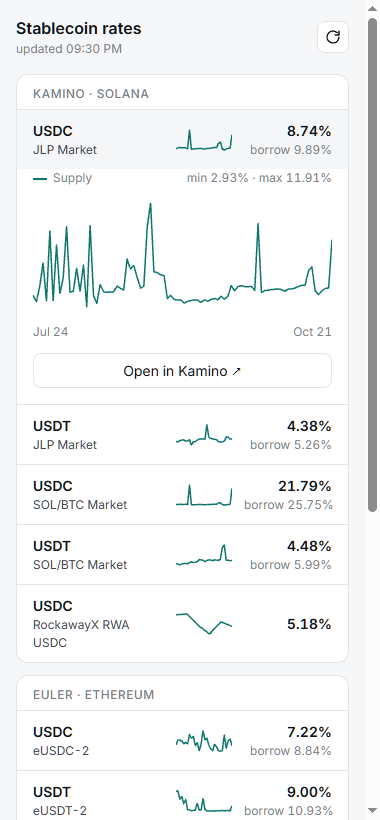

# Stablecoin Rates

A phone-sized widget that shows USDC/USDT lending rates on Kamino, Euler and Aave, and how they move over time.

**Live:** https://rttq.github.io/defi-parse/. Install it from Chrome/Edge (install icon in the address bar) or add it to your phone's home screen.



## What it shows

- Current **supply APY** for 13 pools, and **borrow APY** where the pool allows borrowing
- A 30-day supply trend per pool; tap a pool for a 90-day chart plus the recorded borrow trend
- A link to each pool's page on the protocol, to go and lend
- CSV export of the daily history
- Light and dark theme from the system setting

## How it works

```
 GitHub Actions, daily 06:00 UTC
   defi_parser.py --> DefiLlama /pools + /lendBorrow --> appends to history.csv --> commit

 GitHub Pages (index.html, no build, no backend)
   browser --> DefiLlama /chart/{pool}   supply APY history (free)
           --> DefiLlama /lendBorrow     current borrow APY
           --> history.csv               borrow APY history (recorded here)
           --> watchlist.json            the pools to show
```

DefiLlama's supply history is free; its borrow history is a paid endpoint. That's why the collector records borrow rates itself. Borrow history in this repo starts on 2026-10-21.

Rates come from DefiLlama's hourly snapshots, so a short spike can appear on the protocol's own page up to an hour earlier.

## Pools

All pools are listed in [`watchlist.json`](watchlist.json) by DefiLlama pool id, with a label and a deposit link. To add a pool, add an entry there; the collector and the widget both pick it up without code changes.

| Platform | Pools |
|---|---|
| Kamino (Solana) | JLP Market USDC/USDT, SOL/BTC Market (formerly Main) USDC/USDT, RockawayX RWA USDC vault |
| Euler v2 (Ethereum) | eUSDC-2, eUSDT-2 |
| Aave v3 core | USDC/USDT on Ethereum, Arbitrum, Avalanche |

## Run locally

```bash
pip install requests pandas
python defi_parser.py          # appends today's rows to history.csv
python test_defi_parser.py     # self-check, prints "ok"
python -m http.server          # then open http://localhost:8000
```

## Project history

This started in April 2025 as a vibe-coded Selenium script that scraped Kamino and Euler pages into a CSV. By October 2026 both scrapers returned wrong data without raising errors, because the sites had changed. The rebuild replaced scraping with DefiLlama's API and added the history and the widget. It was planned and tracked with [OpenSpec](https://github.com/Fission-AI/OpenSpec):

- [`openspec/specs/`](openspec/specs): what the collector and the widget are required to do
- [`openspec/changes/archive/`](openspec/changes/archive): the two changes with their proposals, designs and task lists
